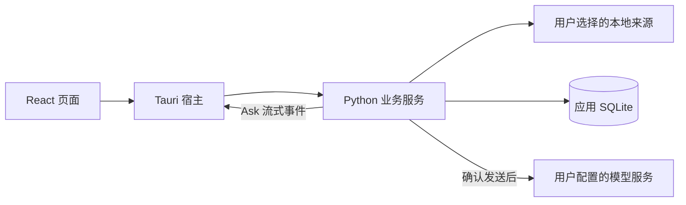

# Today-wechat 架构

React 界面通过 Tauri 调用 Python 业务服务，业务结果保存在本地 SQLite。桌面程序使用 JSONL 传递请求与响应，Ask 的流式事件通过独立 Tauri Channel 转发，没有常驻 HTTP 服务。

## 读取与同步

`backend/reader.py` 读取明确账号、会话和时间内的消息。加密来源使用用户提供的已有密钥，通过临时副本、页面认证和 WAL 已提交边界检查后读取。应用不扫描微信进程内存，也不主动获取密钥。

应用存储与来源分开。同步失败不越过未保存记录推进游标；来源、本人身份和用户范围共同约束后续处理。

## 整理与发布

`backend/analysis.py` 承担候选校验与业务发布。长会话通过 `action_discovery.py` 逐段发现请求和承诺，再整体核对每个候选。无效候选隔离，独立有效事项按事务发布；结构检查不能代替业务语义评测。

`backend/automatic.py` 保存持续授权、冻结批次和执行状态。`backend/meetings.py` 保留完整原文，生成候选后由用户选择加入。`backend/daily_news.py` 处理独立授权下的日报调度和历史。

## Ask

`backend/ask.py` 管理问答范围、发送确认、运行与业务历史；`ask_retrieval.py` 查询本地文字及来源，`ask_provider.py` 适配 OpenAI 兼容和 Gemini 原生服务。

首版 Ask 先检索证据，再生成回答，并支持停止、引用和追问。AG-UI 用于界面事件，模型服务无需实现 AG-UI。当前未接入 Pi Agent，也未提供由 Ask 直接修改待办的工具。

## 凭据与授权

模型配置与用量由 `backend/models.py` 管理。当前密钥以明文保存在本地 SQLite，原有凭据模块兼容迁移与受控检查，不能理解为所有密钥都已受到系统钥匙串保护。

账号、服务配置和范围变化会影响发送授权。发送检查、引用归属、结果校验和用户状态保护由应用执行；模型输出不被直接当作数据库操作。
